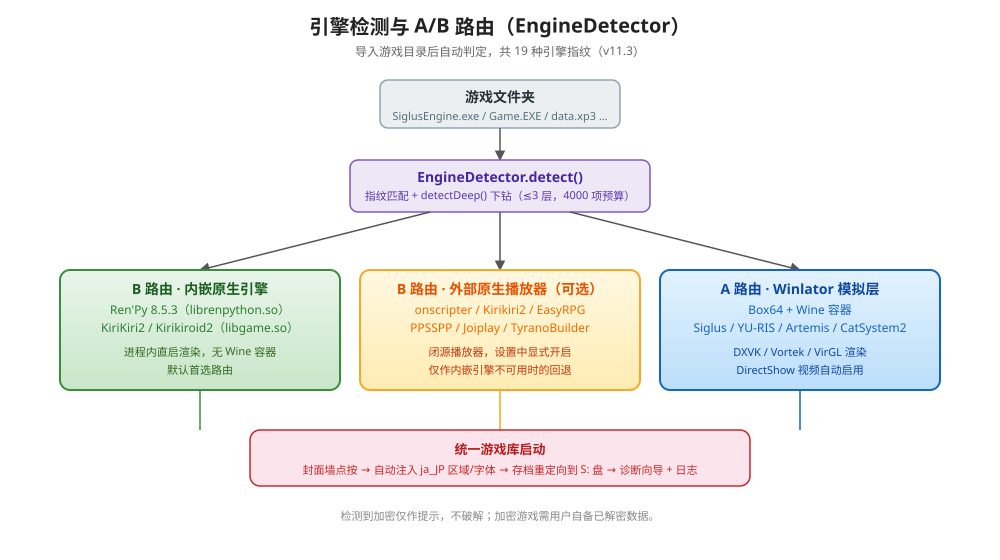
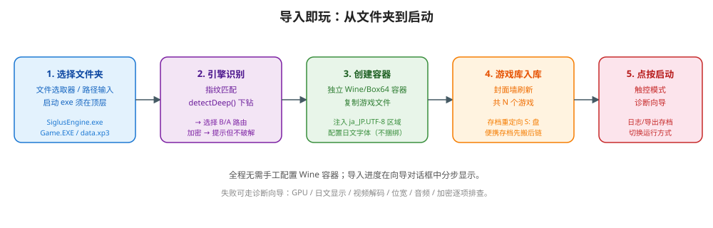
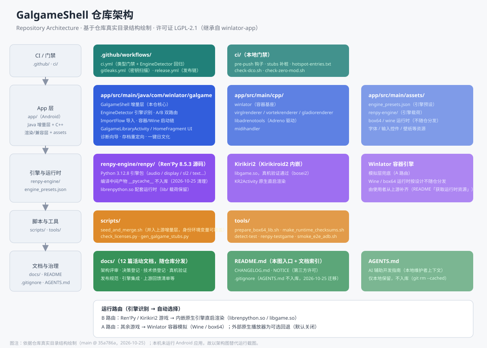

<div align="center">

# GalgameShell

**Galgame 的 Android 运行器 —— 导入即玩，自动识别引擎并路由到原生或模拟层。**
A standalone Android galgame player: import a folder, auto-detect the engine, and play.

[](https://github.com/ReSerendipity/GalgameShell/actions/workflows/ci.yml)
[](https://github.com/ReSerendipity/GalgameShell/releases)
[](LICENSE)


[](docs/CONTRIBUTING.md)
[](https://github.com/ReSerendipity/.github/tree/main/governance)

[中文](#中文) · [English](#english)

</div>

---

## 中文

### 项目简介

**GalgameShell** 是独立的 galgame 安卓运行器，内嵌 [`brunodev85/winlator-app`](https://github.com/brunodev85/winlator-app)（LGPL-2.1）作为 Windows 模拟层**源码组件**——集成与修改标注方式同内嵌的 Kirikiroid2 / Ren'Py，见 [`NOTICE`](NOTICE)。它在 APK 内同时内嵌 Ren'Py 与 Kirikiri2 原生运行时，导入游戏文件夹后自动识别引擎（v11.3 已覆盖 19 种指纹），在「内嵌原生引擎 / 外部原生播放器（可选）/ Winlator 模拟」之间智能路由，无需手工配置 Wine 容器。

> 治理规范：[ReSerendipity/.github/governance](https://github.com/ReSerendipity/.github/tree/main/governance)

### 核心特性

- **导入即玩**：选定游戏目录后自动创建专属容器、复制游戏文件、注入运行环境，导入完成即从封面墙启动。
- **内嵌原生引擎**：APK 内嵌 Ren'Py 8.5.3（`librenpython.so`，Python 3.12.8）与 Kirikiri2 / Kirikiroid2（`libgame.so`），识别到对应引擎的游戏由进程内直启渲染。
- **引擎识别与 A/B 双路由**：通过 19 种引擎指纹（Siglus / YU-RIS / Artemis / CatSystem2 / AdvHD / SystemNNN / BGI / CMVS / Unity 等）自动选择运行方式；`detectDeep()` 支持有限深度下钻。
- **一键日文化**：自动注入 `LC_ALL=ja_JP.UTF-8` 区域环境与日文字体配置，解决日文游戏乱码（字体文件不随应用捆绑）。
- **游戏内视频播放**：自动启用 DirectShow / Windows Media 解码，老游戏开场动画与过场视频可正常播放。
- **存档重定向**：存档统一重定向到 S: 盘与 Shell Folder，便携存档自动「先搬后链」，支持导出与恢复。
- **诊断向导与日志**：GPU、日文显示、视频解码、位宽、音频、加密逐项检查；日志自动提取要害行。
- **统一游戏库**：导入、启动、诊断、日志、存档、原生路由开关集中在一处。

### 展示



> **引擎路由**：导入后由 EngineDetector 判定引擎类型，优先走内嵌原生引擎（B 路由），不可用时可唤起外部原生播放器作为可选回退，其余游戏走 Winlator Box64+Wine 模拟层（A 路由）。



> **导入流程**：选择文件夹 → 引擎识别 → 创建容器并注入区域/字体 → 封面墙入库 → 点按启动。全程向导对话框分步显示进度。



> **仓库架构**：依据仓库真实目录结构绘制（main @ f466b3a），展示 `app/`、`ci/`、`docs/`、`tools/` 与内嵌 Winlator 组件的关系。

> **注**：应用运行截图需在 ARM64 Android 真机（Vulkan 1.1+）上采集，当前 README 以架构图与流程图替代；真机验收记录见 [`docs/real-device-verification.md`](docs/real-device-verification.md)。

### 快速开始

#### 前置环境

- JDK 17
- Android SDK（platform-35、NDK 24.0.8215888）
- Git（用于从 Winlator 组件官方仓库补齐运行时资源）

#### 1. 克隆并补齐运行时资源

本仓库**按设计不附带大二进制运行时**：Wine / Box64 运行时（`*.tzst`）与各架构原生库（`*.so`）不随源码分发。因此 clone 之后**不能直接 `./gradlew assembleDebug` 出完整可用的 APK**，需先从 Winlator 组件官方仓库补齐这部分资源（`upstream` 远端即组件官方仓库，兼作按需移植官方修复的来源）：

```bash
git clone https://github.com/ReSerendipity/GalgameShell.git
cd GalgameShell

# 从上游取回被排除的运行时资源与 native 库（只落工作区，不写索引）
git remote add upstream https://github.com/brunodev85/winlator-app
git fetch upstream
git restore --source=upstream/main --worktree -- app/src/main/assets app/src/main/jniLibs
```

> ⚠️ 不要用 `git checkout upstream/main -- <路径>`：带 tree-ish 的 checkout 会写索引，把本应排除的大二进制纳入暂存。用 `git restore --worktree` 形式保持 `git status` 干净。

#### 2. 配置 SDK 并构建

```bash
# 项目根目录 local.properties
echo "sdk.dir=/path/to/android-sdk" > local.properties

./gradlew assembleDebug
```

输出 APK：`app/build/outputs/apk/debug/app-debug.apk`。

#### 3. 最小验证（不补大二进制）

若只想验证框架侧代码（无需 Android SDK，仅需 JDK 17），执行与 CI `galgame-compile` job 一致的三步 javac 检查：

```bash
rm -rf /tmp/stubs-out /tmp/check /tmp/hot
mkdir -p /tmp/stubs-out /tmp/check /tmp/hot
javac -d /tmp/stubs-out $(find ci/stubs -name '*.java')
javac -Xlint:all -cp /tmp/stubs-out -d /tmp/check $(find app/src/main/java/com/winlator/galgame -name '*.java')
javac -Xlint:all -cp /tmp/stubs-out:/tmp/check -d /tmp/hot \
  $(grep -vE '^[[:space:]]*(#|$)' ci/hotspot-entries.txt)
```

### 系统要求与兼容性

| 项目 | 要求 |
|---|---|
| Android 版本 | 11（API 30）或更高 |
| CPU 架构 | ARM64（arm64-v8a） |
| GPU | 支持 Vulkan 1.1+；Mali GPU 可走 Vortek / VirGL 兜底 |
| 存储 | 预留 8–16 GB |
| 内存 | 建议 12 GB 及以上 |
| 不支持 | 无 Vulkan 能力的设备（如部分 Kirin 平台） |

> **模拟器 UI 调试**：可用 `-PgalgameUiAbi=x86_64` 构建 x86_64 APK 仅调试 UI 层（游戏库/主题/布局），此模式跳过原生编译，但 Wine/Box64 运行时不可用。

### 使用示例

1. 安装 APK 后打开应用，底部导航为「游戏库 / 容器管理 / 工具 / 设置」四个 Tab。
2. 点「导入游戏」选择存放 galgame 的文件夹（启动 exe 须在所选文件夹顶层）。
3. 向导自动检测引擎、创建容器、复制文件并注入日文环境。
4. 回到游戏库，点封面墙中的游戏卡片即可启动。
5. 长按卡片可查看详情、诊断、导出存档或切换运行方式。

### 常见问题

**Q：构建报错找不到 `librenpython.so` / `*.tzst`？**
A：你还没补齐运行时资源。按上文「获取运行时资源」一节执行 `git restore --source=upstream/main --worktree -- app/src/main/assets app/src/main/jniLibs`。

**Q：`./gradlew` 下载 gradle-8.14.5-bin.zip 失败（PKIX 报错）？**
A：代理/TLS 拦截导致。先检查 `~/.gradle/wrapper/dists/` 是否有完整版本，有则直接调用其二进制加 `--offline`；详见 README 原文与 [`ci/pre-push`](ci/pre-push)。

**Q：支持哪些引擎？**
A：v11.3 已识别 19 种引擎指纹，包括 SiglusEngine、YU-RIS、Artemis、CatSystem2、AdvHD、SystemNNN、BGI、CMVS、Unity 等；识别逻辑见 [`app/src/main/java/com/winlator/galgame/`](app/src/main/java/com/winlator/galgame/)。

**Q：检测到加密怎么办？**
A：应用仅作提示，不做破解。请自备已合法获得的、可直接运行的游戏文件。

**Q：为什么 Release 里没有 APK？**
A：本项目为源码分发，Release 仅附源码 SBOM（CycloneDX）与 SHA256SUMS。完整 APK 需自行按上文构建，或从可信渠道获取。

### 文档与治理

- [架构评审记录](docs/ARCHITECTURE-REVIEW.md)
- [原生引擎内嵌方案](docs/native-engine-integration.md)
- [真机验证报告](docs/real-device-verification.md)
- [全屏修复复盘](docs/fullscreen-fix-retrospective.md)
- [发布 / 回滚规范](docs/release-governance.md)
- [技术债登记表](docs/tech-debt-register.md)
- 完整文档索引见 [`docs/`](docs/)

### 贡献 / 安全 / 支持

- 欢迎 Issue 与 PR。本仓采用 DCO：所有提交须带 `Signed-off-by`（`git commit -s` 自动追加）。
- 本地类型门禁：`cp ci/pre-push .git/hooks/pre-push && chmod +x .git/hooks/pre-push`
- 改动 Winlator 组件文件前，先核对 [`ci/zero-mod-exceptions.md`](ci/zero-mod-exceptions.md)——它同时是 LGPL-2.1 §2 的修改标注与移植官方修复时的冲突面清单。
- 详细贡献指南见 [`docs/CONTRIBUTING.md`](docs/CONTRIBUTING.md)

### 许可证

整体以 LGPL-2.1 发布：Winlator 组件部分继承 LGPL-2.1（不可更授），GalgameShell 增量层亦以 LGPL-2.1 发布（自主选择，保持整仓单许可证，见决策 A8）。第三方组件与字体政策详见 [`NOTICE`](NOTICE)。

---

## English

### Introduction

**GalgameShell** is a standalone Android galgame player that embeds [Winlator](https://github.com/brunodev85/winlator-app) (LGPL-2.1) as its Windows-emulation source component — with modifications marked, same pattern as the bundled Kirikiroid2 / Ren'Py engines (see [`NOTICE`](NOTICE)). It also embeds Ren'Py and Kirikiri2 native runtimes inside the APK. After you pick a game folder, GalgameShell auto-detects the engine (19 fingerprints in v11.3) and routes the game to the embedded native engine, an optional external native player, or the Winlator emulation layer — no manual Wine container configuration needed.

> Governance: [ReSerendipity/.github/governance](https://github.com/ReSerendipity/.github/tree/main/governance)

### Features

- **Import and play**: Pick a game folder; GalgameShell creates an isolated container, copies files, and injects the runtime. Tap the cover art to launch.
- **Embedded native engines**: Ren'Py 8.5.3 (`librenpython.so`, Python 3.12.8) and Kirikiri2 / Kirikiroid2 (`libgame.so`) are bundled; matching games run in-process without Wine.
- **Engine detection and A/B routing**: 19 engine fingerprints (Siglus / YU-RIS / Artemis / CatSystem2 / AdvHD / SystemNNN / BGI / CMVS / Unity …); `detectDeep()` supports bounded deep scanning.
- **One-tap Japanese locale**: Auto-injects `ja_JP.UTF-8` and configures Japanese fonts to fix mojibake (fonts are not bundled).
- **In-game video**: Auto-enables DirectShow / Windows Media decoding for intros and cutscenes.
- **Save redirection**: Saves are redirected to drive S: and Shell Folder; portable saves are relocated and symlinked; export/restore supported.
- **Diagnostics wizard and logs**: Step-by-step checks for GPU, Japanese display, video decode, bit width, audio, and encryption; logs auto-extract relevant lines.
- **Unified game library**: Import, launch, diagnose, logs, saves, and native-route toggles in one place.

### Showcase


> **Engine routing**: After import, EngineDetector picks the route — embedded native engine (Route B, default), optional external native player fallback, or Winlator Box64+Wine emulation (Route A).


> **Import flow**: Pick folder → detect engine → create container and inject locale/fonts → appear in cover wall → tap to launch. Progress is shown step by step in a wizard dialog.


> **Repository architecture**: Drawn from the actual directory tree (main @ f466b3a), showing `app/`, `ci/`, `docs/`, `tools/`, and the embedded Winlator component.

> **Note**: Runtime screenshots require an ARM64 Android device with Vulkan 1.1+. This README uses architecture and flow diagrams instead; real-device verification records are in [`docs/real-device-verification.md`](docs/real-device-verification.md).

### Quick Start

#### Prerequisites

- JDK 17
- Android SDK (platform-35, NDK 24.0.8215888)
- Git (to fetch runtime assets from upstream)

#### 1. Clone and fetch runtime assets

This repo **by design does not bundle large binary runtimes**: Wine / Box64 rootfs (`*.tzst`) and native libs (`*.so`) are distributed separately.

```bash
git clone https://github.com/ReSerendipity/GalgameShell.git
cd GalgameShell

# Restore excluded runtime assets and native libs (worktree only, not staged)
git remote add upstream https://github.com/brunodev85/winlator-app
git fetch upstream
git restore --source=upstream/main --worktree -- app/src/main/assets app/src/main/jniLibs
```

> ⚠️ Do **not** use `git checkout upstream/main -- <path>`: tree-ish checkout stages the files, and `.gitignore` no longer applies to staged paths — a later `git commit` would bundle the large binaries. Use `git restore --worktree` so `git status` stays clean.

#### 2. Configure SDK and build

```bash
echo "sdk.dir=/path/to/android-sdk" > local.properties
./gradlew assembleDebug
```

Output: `app/build/outputs/apk/debug/app-debug.apk`.

#### 3. Minimal verification (without large binaries)

To validate the framework-side code only (JDK 17, no Android SDK), run the same three javac gates as CI's `galgame-compile` job:

```bash
rm -rf /tmp/stubs-out /tmp/check /tmp/hot
mkdir -p /tmp/stubs-out /tmp/check /tmp/hot
javac -d /tmp/stubs-out $(find ci/stubs -name '*.java')
javac -Xlint:all -cp /tmp/stubs-out -d /tmp/check $(find app/src/main/java/com/winlator/galgame -name '*.java')
javac -Xlint:all -cp /tmp/stubs-out:/tmp/check -d /tmp/hot \
  $(grep -vE '^[[:space:]]*(#|$)' ci/hotspot-entries.txt)
```

### Requirements and Compatibility

| Item | Requirement |
|---|---|
| Android | 11 (API 30) or newer |
| CPU | ARM64 (arm64-v8a) |
| GPU | Vulkan 1.1+; Mali GPUs fall back to Vortek / VirGL |
| Storage | 8–16 GB free |
| RAM | 12 GB+ recommended |
| Not supported | Devices without Vulkan (e.g. some Kirin platforms) |

> **Emulator UI debugging**: Build with `-PgalgameUiAbi=x86_64` to produce an x86_64 APK for UI-only debugging (skips native compilation). Wine/Box64 runtime is not available in this mode.

### Usage

1. Install the APK and open the app. Bottom navigation has four tabs: **Library / Containers / Tools / Settings**.
2. Tap **Import Game** and pick a folder containing your galgame (the launcher exe must be at the top level).
3. The wizard detects the engine, creates a container, copies files, and injects Japanese locale.
4. Return to the library and tap the game card to launch.
5. Long-press a card for details, diagnostics, save export, or engine-route override.

### FAQ

**Q: Build fails with missing `librenpython.so` / `*.tzst`?**
A: You haven't fetched the runtime assets yet. Run the `git restore --source=upstream/main --worktree -- …` step above.

**Q: `./gradlew` fails downloading gradle-8.14.5-bin.zip (PKIX error)?**
A: TLS interception in a proxy/VPN environment. Check `~/.gradle/wrapper/dists/` for a complete alternative version and invoke its binary with `--offline`. See the build notes in this file and [`ci/pre-push`](ci/pre-push).

**Q: Which engines are supported?**
A: v11.3 detects 19 engine fingerprints including SiglusEngine, YU-RIS, Artemis, CatSystem2, AdvHD, SystemNNN, BGI, CMVS, Unity, and more. Detection logic lives in [`app/src/main/java/com/winlator/galgame/`](app/src/main/java/com/winlator/galgame/).

**Q: What about encrypted games?**
A: The app detects encryption and warns, but does not crack. Please provide legally obtained, directly runnable game files.

**Q: Why is there no APK attached to Releases?**
A: This project distributes source only. Releases attach a CycloneDX SBOM and SHA256SUMS. Build the APK yourself per the instructions above, or obtain it through trusted channels.

### Documentation and Governance

- [Architecture review records](docs/ARCHITECTURE-REVIEW.md)
- [Native engine integration notes](docs/native-engine-integration.md)
- [Real-device verification report](docs/real-device-verification.md)
- [Fullscreen fix retrospective](docs/fullscreen-fix-retrospective.md)
- [Release / rollback governance](docs/release-governance.md)
- [Technical debt register](docs/tech-debt-register.md)
- Full index: [`docs/`](docs/)

### Contributing / Security / Support

- Issues and PRs welcome. This repo uses DCO: every commit must carry a `Signed-off-by` trailer (`git commit -s`).
- Local type gate: `cp ci/pre-push .git/hooks/pre-push && chmod +x .git/hooks/pre-push`
- Before modifying Winlator component files, check [`ci/zero-mod-exceptions.md`](ci/zero-mod-exceptions.md) — it is both the LGPL-2.1 §2 modification-notice register and the conflict surface list when porting upstream fixes.
- Full guide: [`docs/CONTRIBUTING.md`](docs/CONTRIBUTING.md)

### License

The whole project is released under LGPL-2.1: the Winlator component inherits LGPL-2.1 (cannot be re-licensed), and the GalgameShell delta layer is also released under LGPL-2.1 (deliberate choice to keep a single license across the repo, see decision A8). Third-party components and font policy are listed in [`NOTICE`](NOTICE).
